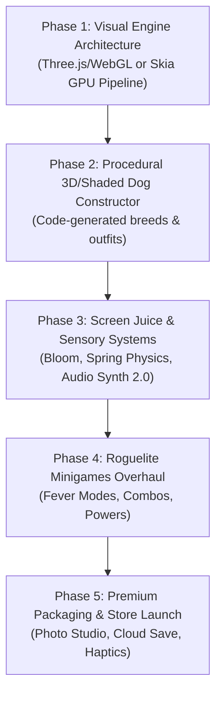

# DODGE BLOCK DOGS (DBD) — MASTER GAME DESIGN & TECHNICAL OVERHAUL PLAN
**From 2D Prototype to Commercial-Grade Premium Mobile Experience**

---

## 1. EXECUTIVE AUDIT & CURRENT STATE ANALYSIS

### 1.1 Architecture & Tech Stack Overview
The current repository is an **Expo (SDK 58) / React Native 0.88** container wrapping a single 2,165-line HTML5 Canvas application (`assets/game.html` and `index.html`) loaded inside `react-native-webview`.

```
┌──────────────────────────────────────────────────────────┐
│              React Native Host (App.js)                 │
│  - Expo Haptics Bridge (postMessage listener)           │
│  - Asset Loading (expo-asset)                            │
└────────────────────────────┬─────────────────────────────┘
                             │ WebView (file://)
┌────────────────────────────▼─────────────────────────────┐
│                 assets/game.html                         │
│  - 2D Canvas Engine (requestAnimationFrame, 60 FPS)      │
│  - Procedural Pixel Dog Rasterizer (fillRect offscreen)  │
│  - Web Audio API Chiptune Synth (OscillatorNode)         │
│  - Tamagotchi Vitals Loop (Hunger, Energy, Fun)          │
│  - 4 Arcade Minigames (Dodge, Catch, Jump, Lane)         │
│  - Wardrobe & Unlock Shop (localStorage)                 │
└──────────────────────────────────────────────────────────┘
```

### 1.2 What Works Well (Existing Strengths)
1. **Self-Contained & Zero Dependencies**: The canvas game runs with zero external JS libraries; it operates immediately without build-step overhead for the core game.
2. **Sprite Caching Architecture**: Offscreen canvas caching (`renderDogToCanvas` -> `getCachedDogSprite`) avoids re-rasterizing the dog on every frame, maintaining a clean 60 FPS baseline.
3. **Core Hybrid Loop**: Combining Tamagotchi pet care with fast arcade minigames is an inherently addictive concept (proven by titles like *Pou*, *My Talking Tom*, and *Tamagotchi Connection*).
4. **Haptic Integration**: Using `window.ReactNativeWebView.postMessage` to trigger native `expo-haptics` provides tactile feedback for hits and clicks.

### 1.3 Critical Bottlenecks Preventing Commercial Viability
Why players won't pay ($2.99 – $4.99) for the game in its current state:
1. **Programmer-Art Visuals**: Dogs, hazards, and items are rendered via primitive colored boxes (`fillRect`). The visual perception is that of a student or jam prototype.
2. **WebView Input Latency**: Touch events inside a WebView suffer from a 1 to 3 frame latency penalty compared to native GPU surfaces. In high-speed twitch minigames (Lane, Jump), this makes controls feel slightly unresponsive.
3. **Flat Audio Landscape**: Monophonic oscillator beeps (sine/saw/square) become abrasive after 2 minutes. Commercial games rely on dynamic musical layers, FM chime chords, and organic sound design.
4. **Shallow Metagame Loop**: Vitals simply tick down linearly; minigames lack roguelite modifiers, combo multipliers, fever states, dynamic camera choreography, and emotional payoff.

---

## 2. THE VISUAL REVOLUTION: ASTOUNDING GRAPHICS WITHOUT ASSETS

The user's central dilemma: **"My main objective is graphics are astounding, but there are not many assets. Should we generate them by code, construct them, or use Scratch / CC0 packs?"**

### 2.1 Why Scratch / CC0 Packs are a Trap for Commercial Games
- **Style Incoherence**: Pulling free sprites from Scratch or CC0 asset sites results in the "Frankenstein aesthetic"—mismatched pixel grids (e.g. 16x16 next to 32x32), clashing color palettes, and inconsistent lighting angles.
- **Low Perceived Value**: Gamers can instantly recognize generic asset packs. Paid indie hits (*Monument Valley*, *Crossy Road*, *Mini Metro*, *Superhot*, *Townscaper*) succeed because they have a **singular, coherent visual identity**.
- **Lack of Dynamic Customization**: With pre-baked sprite sheets, fitting 10 different hats, glasses, and outfits across 8 breeds requires drawing dozens of permutation frames manually.

---

### 2.2 The Three High-End Graphical Pathways

| Feature | Option 1: Procedural 3D Voxel/Stylized Low-Poly (RECOMMENDED) | Option 2: 2D Hardware Shaders (RN Skia / WebGL) | Option 3: Procedural AI/Vector Asset Generator |
| :--- | :--- | :--- | :--- |
| **Technology** | Three.js / WebGL / React Three Fiber | `@shopify/react-native-skia` or PixiJS | Node.js SVG generator + Palette Mapper |
| **Aesthetic Model** | *Crossy Road*, *Monument Valley*, *Cozy Grove* | *Geometry Wars*, *Vampire Survivors*, *Juice Galaxy* | High-res 32-bit Neo-Pixel Art |
| **Asset Needs** | **Zero 2D/3D artist assets needed**; geometry is generated via math/cubes | **Zero sprite assets needed**; drawn via GLSL fragment shaders | Pre-generated sprite sheets |
| **Visual Wow Factor** | ★★★★★ (Physical toy look, dynamic soft shadows, tilt-shift, rim lighting) | ★★★★☆ (Vibrant neon glow, 120 FPS fluid particles, light trails) | ★★★☆☆ (Static unless animated frame-by-frame) |
| **Customization** | Infinite (hats & glasses are 3D meshes parented to bones) | Moderate (2D layer compositing) | Hard (requires sprite matrix) |

---

### 2.3 The Recommended Blueprint: "Tactile Vinyl Toy / Voxel Kawaii"

Instead of attempting to hire an artist or piecing together low-quality 2D clips, **construct the game in procedural 3D with isometric tilt-shift and stylized lighting**:

```
                              ┌──────────────────────┐
                              │  PROCEDURAL 3D MESH  │
                              │  Rounded Cubes &     │
                              │  Beveled Primitives  │
                              └──────────┬───────────┘
                                         │
        ┌────────────────────────────────┼────────────────────────────────┐
        │                                │                                │
┌───────▼──────────────┐       ┌─────────▼────────────┐        ┌──────────▼───────────┐
│ DYNAMIC LIGHTING     │       │ SQUASH & STRETCH     │        │ POST-PROCESSING      │
│ - Soft Sun Shadow    │       │ - Spring physics     │        │ - Tilt-shift blur    │
│ - Ambient Occlusion  │       │ - Wobble on tap      │        │ - Gentle Bloom       │
│ - Rim Light Halo     │       │ - Tail wag curve     │        │ - Vignette & Grain   │
└──────────────────────┘       └──────────────────────┘        └──────────────────────┘
```

#### Why This Works Miracles Without Artists:
1. **Procedural Geometry by Code**:
   A dog is modeled in code using a small hierarchy of beveled boxes:
   - Body: Rounded box with smooth corners (`BoxGeometry` with sub-divided chamfer or SDF raymarch).
   - Head: Box with ear meshes and a snout cube.
   - Eyes: Two shiny dark spheres with white specular reflections.
   - Legs: 4 jointed cuboids that bob with procedural walking sine waves.
2. **Lighting Does 80% of the Heavy Lifting**:
   Directional warm sunlight + cool blue ambient sky light + contact shadow immediately makes simple shapes look like premium, physical designer vinyl toys (like Funko / Kidrobot collectibles).
3. **Tilt-Shift & Depth of Field (DoF)**:
   A slight depth-of-field blur on the foreground and background creates a miniature "diorama" effect that turns simple procedural objects into breathtaking, tactile eye candy.

---

## 3. GAMEPLAY & VALUE PROPOSITION: WHAT MAKES PEOPLE PAY $2.99 – $4.99

A free game annoys players with ads. A **paid game** respects the player's time and delivers premium polish:

### 3.1 The "Juice" Standard (Sensory Feedback Matrix)
Every single interaction must trigger multi-sensory delight:
- **Tapping Pet**:
  - Squash down by 15%, spring up by 25% with dampened oscillation.
  - Heart particle explosion with random hue shifts and rotational spin.
  - Sweet pentatonic chime that pitches up with consecutive taps (Combo chime: C5 -> D5 -> E5 -> G5 -> A5).
  - Heavy haptic thump followed by light settling pulses.
- **Dodge Minigame Near-Miss**:
  - Slow-motion bullet-time effect (speed drops to 0.3x for 150ms).
  - Screen edge vignette flashes cyan.
  - Whoosh synth frequency sweep + light haptic buzz.
  - Floating "+50 NEAR MISS!" stylized text that scales and floats up.
- **Game Over Impact**:
  - Freeze frame (hit-stop for 80ms).
  - Chromatic aberration burst (RGB split).
  - Radial screen shake decaying along an exponential curve.
  - Dog drops into a dizzy star animation.

---

### 3.2 Minigame Roguelite Evolution (From Boring to Addictive)

| Minigame | Current Prototype State | Commercial Overhaul |
| :--- | :--- | :--- |
| **Block Dodge** | Falling red boxes with `!` text | **Cyber Grid Descent**: Floating platforms, laser grid sweeps, temporary shield bubbles, magnet pick-ups, and speed warp stages. |
| **Treat Catch** | Falling brown bones and anvils | **Gourmet Rush**: Golden bones, rainbow cupcakes (fever mode: all hazards turn into treats for 5 seconds), bouncing trampolines. |
| **Roof Jump** | Basic box jumping over spikes | **Neon Rooftop Parkour**: Double jumps, wall slides, grind rails, dynamic skyline sunset moving in multi-layer 3D parallax. |
| **Cyber Lane** | 3 static lanes with gray cars | **Synthwave Highway**: Traffic density scaling, boost pads with FOV camera stretch, police dog sirens, drift turns. |

---

### 3.3 Pet Personality & Emotional Investment
- **Unique Breed Traits**:
  - *Shiba Inu*: Aloof, dramatic side-eye, gets hyper zoomies after eating.
  - *Pug*: Lazy, breathes loudly, snores with musical Z's, loves sleeping.
  - *Husky*: Vocal (procedural melodious barks), throws tantrums if energy is too high.
  - *Cyberdog*: Glitch particles, robotic bleeps, charges on a neon docking pad.
- **Polaroid Photo Studio**: Players can pose their styled dog in custom photo stages, apply vintage filters and stickers, and export high-res shareable cards to Instagram / TikTok.

---

## 4. PHASED TECHNICAL IMPLEMENTATION ROADMAP



### Phase 1: Visual Engine Upgrade
- Integrate WebGL / Three.js (inside WebView or via Expo GL) to enable hardware-accelerated 3D shaders, shadows, and post-processing.
- Set up an isometric camera with fixed orthographic or low-FOV perspective, calibrated for mobile aspect ratios (16:9 to 21:9).
- Implement a global lighting rig: Key Directional Light with soft shadow map, Ambient Light, and dynamic Rim Light.

### Phase 2: Procedural 3D Mesh Constructor
- Build the `ProceduralDogBuilder` class in code:
  - Generates breed body dimensions, ear shapes (floppy, pointed, folded), snout lengths, and tail curves.
  - Generates accessories as snap-on procedural meshes (Chef Hat, VR Visor, Detective Fedora, Gold Chain).
  - Implements bone hierarchy: Root -> Spine -> Head -> Ears, Legs, Tail.
- Add procedural animation controllers:
  - Idle breathing (subtle chest scale oscillation).
  - Walk cycle (alternating leg angles with hip sway).
  - Happy wag (high-frequency tail wag + head tilt).

### Phase 3: Post-Processing & Screen Juice
- Implement post-processing passes:
  - Unreal-style Bloom for neon elements and power-ups.
  - Depth-of-Field / Tilt-Shift for the toy-diorama aesthetic.
  - Screen Shake controller with trauma decay algorithm ($Trauma^2$).
- Upgrade Audio Synthesizer:
  - Polyphonic FM synth for rich, dreamy chords.
  - Pentatonic scale quantization for all interactive clicks and catches.

### Phase 4: Minigame Gameplay Depth
- Refactor the 4 minigames to include:
  - Multiplier combo bar ($1x \to 2x \to 4x \to 8x \to FEVER$).
  - Power-up spawning system (Magnet, Time Freeze, Golden Shield).
  - Dynamic procedural obstacle generation with rhythmic pacing.

### Phase 5: Commercial Monetization & Polishing
- Implement local persistence with encrypted backup / cloud sync.
- Create Dog Diary / Achievement scrapbook with unlockable rewards.
- Design high-fidelity app store icons, banners, and preview video scripts.

---

## 5. SKILLS & TOOLING STRATEGY

To execute this plan smoothly, we recommend setting up dedicated developer tooling:
1. **Procedural Shader & Mesh Previewer**: A live interactive preview mode to adjust dog geometry, lighting angles, and shader colors in real-time.
2. **Sound Synthesis Studio**: Code presets for tuning audio envelopes, pitch ramps, and harmonic chords without guessing numbers.
3. **Automated Verification**: End-to-end performance checks ensuring steady 60 FPS on low-tier mobile devices without battery overheating.
