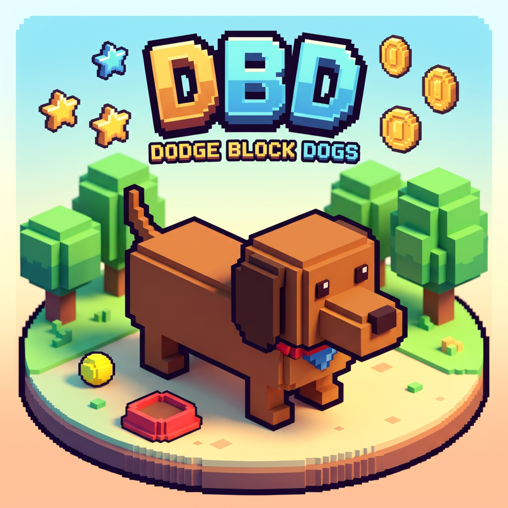
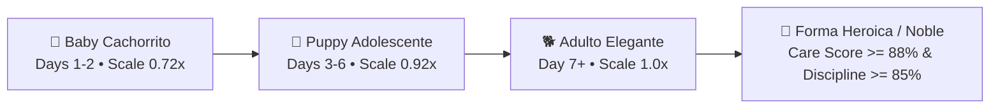

# 🐾 Dodge Block Dogs (DBD)

<div align="center">



### *A Nostalgic 1990s Tamagotchi Virtual Pet Simulator × 10-Game Retro Arcade Cabinet*

[](https://expo.dev)
[](https://reactnative.dev)
[](https://threejs.org)
[](#audio-engine)
[](#100-zero-microtransactions)
[](#multi-language-support)
[](LICENSE)

[🕹️ **Play Live on Web**](https://mwveliz.github.io/dodge-block-dogs/) &bull; [🎮 **Itch.io Store**](https://mwveliz.itch.io/dodge-block-dogs) &bull; [🚀 **Official Landing Launcher**](https://mwveliz.github.io/dodge-block-dogs/landing.html) &bull; [📦 **Download Offline ZIP**](https://mwveliz.github.io/dodge-block-dogs/dodge-block-dogs-itchio.zip)

</div>

---

## 📖 Overview

**Dodge Block Dogs (DBD)** is an indie passion project developed by **Miguel Delgado Veliz**. It combines the deep, emotional routine of a classic **1996 Bandai-style Tamagotchi** with a fast-paced, multi-cartridge **10-game retro arcade cabinet**.

Everything runs on a unified, high-performance architecture powered by **Three.js 3D rendering**, an **8-bit chiptune audio synthesizer** (using the Web Audio API with zero external audio assets), and a reactive 2D pixel-art HUD.

---

## ✨ Key Features

### 🐶 1. Tamagotchi Virtual Pet Simulator

- **Real-Time Vitals System**: Monitor your puppy's **Hunger** (🥣), **Happiness** (💖), **Energy** (⚡), **Hygiene** (🫧), **Stress** (💢), and **Discipline** (🎓).
- **Poop & Cleaning Mechanics**: Fed puppies periodically generate pixel poops that degrade hygiene over time. Clean up with the flush button before your dog gets sick!
- **Sickness & Medicine**: Low hygiene triggers illness with animated thermometer status. Administer medical care (`💊`) to restore vitality.
- **Bedtime & Lighting**: Switch the room lights off (`💡`) to allow your puppy to sleep peacefully, regenerating energy at 3× speed while relieving stress.
- **Authentic 1996 LCD Dot-Matrix Mode**: Toggle the vintage monochrome green-phosphor scanline LCD bezel mode at any time with a single tap.
- **Living Room Toys**:
  - `🦆 Pato Sonoro`: Squeaky duck toy with pitch-modulated sound effects, puppy wobble reactions, and stress relief.
  - `🥏 Frisbee Toss`: Launch the 3D physics ball across the living room for high-energy fetch sessions.
- **Dynamic 4-Phase Weather Engine**:
  - **Día ☀️**: Bright morning sunshine with warm directional lighting.
  - **Atardecer 🌇**: Golden-hour amber radiance and deep room shadows.
  - **Noche 🌙**: Cozy midnight moonlight with dimmed interior ambiance.
  - **Lluvia 🌧️**: Atmospheric rainfall featuring animated canvas raindrops and soft thunder ambiance.

---

### 🧬 2. Life-Stage Evolution System

Your dog grows and evolves dynamically based on your care quality, discipline routines, and age:



- **👑 Noble Hero Form**: Exceptional pet owners unlock the legendary 3D Hero Form, equipping the dog with an animated **golden glowing halo** (`THREE.TorusGeometry`) and a **flowing red hero cape** (`THREE.BoxGeometry`).

---

### 🐕 3. Dog Breeds Roster

| Breed | Name (ES / EN) | Profile & Personality | Special Traits |
|---|---|---|---|
| **Golden Retriever** | **Buster** | Loyal, sunny, family companion | Balanced speed, high cuddle factor |
| **Corgi** | **Pixel** | Energetic, short-legged speedster | High agility, joyful wiggles |
| **Siberian Husky** | **Shadow** | Arctic runner with piercing blue eyes | High speed, wild spirit |
| **Great Dane Puppy** | **Mora / Little Blackberry** | Slender, noble black baby Great Dane | Long elegant legs, gentle giant soul |

---

### 🌳 4. Outdoor Park & Discovery Walk (`SCREENS.PARK_WALK`)

- **Interactive Retro Trail**: Take your dog on outdoor strolls along a parallax-scrolling trail with trees (`🌲`), flowering bushes (`🌸`), benches (`🪑`), and hydrants (`🚒`).
- **`[🔍 RASTREAR]` Sniff & Dig**: Your dog sniffs bushes and dig spots, exhuming buried bone caches (+5 to +20 bones).
- **`[🐾 SALUDAR]` Dog Park Greetings**: Encounter friendly neighborhood dogs for instant happiness (+18) and discipline (+5) boosts.

---

### 🕹️ 5. The 10-Game Retro Arcade Cabinet

All minigames feature **high-score tracking**, **combo multipliers (1× to 4×)**, **Fever Mode triggers**, and bone payouts:

| # | Minigame | Genre / Inspiration | Gameplay Mechanic |
|:---:|---|---|---|
| **1** | **Dodge Blocks** | Classic Dodge Arcade | Dodge falling pixel blocks; collect Shields (`🛡️`), Magnets (`🧲`), and Slow-Mo (`⏱️`). |
| **2** | **Bone Catch** | Catch & Gather | Catch falling steaks, cupcakes, and bones while dodging heavy iron anvils. |
| **3** | **Puppy Jump** | Vertical Platformer | Ascend endless cloud platforms and bounce on spring pads to climb higher. |
| **4** | **3-Lane Highway** | Fast Lane Runner | Reflexive lane-shifting across a 3-lane cyber-road dodging traffic barriers. |
| **5** | **Tamagotchi Guess** | 1996 LCD Classic | Authentic 5-round head-turning prediction game with dot-matrix LCD graphics. |
| **6** | **Bone Bounce** | Breakout / Arkanoid | Keep the golden bone bouncing on your puppy paddle to demolish ceiling bricks. |
| **7** | **Space Invadogs** | Space Invaders / Shmup | Equip an astro-jetpack, fire lasers (`⚡`), and eliminate descending alien block-cats. |
| **8** | **Puppy Flap** | Flappy Retro Flight | Tap/Space to flap through glowing neon bone gates with dynamic wing tilting. |
| **9** | **Doggo Digger** | Dig Dug / Mr. Driller | Drill down a 5-column stratum grid for buried bone fossils, gems, and battery stamina. |
| **10** | **Rhythm Bark** | Dance Dance / Beatmania | 4-lane rhythm tracks. Tap falling note treats on the beat line for `PERFECT!` ratings. |

---

### 🛡️ 6. 100% Zero Microtransactions

> [!IMPORTANT]
> **Dodge Block Dogs is 100% free-to-play in the truest sense:**
> - **No real-money in-app purchases (IAP)**.
> - **No paywalls, timers, or energy limiters**.
> - **No ads or behavioral trackers**.
> - Every single bone, food recipe, hat, pair of glasses, bandana, life-stage evolution, and minigame is unlocked **exclusively by playing the game**.

---

### 🌍 7. Multi-Language Support

Switch languages seamlessly on the dashboard with instant UI re-translation:
- 🇪🇸 **Español**
- 🇺🇸 **English**
- 🇯🇵 **日本語 (Japanese)**
- 🇧🇷 **Português (Portuguese)**

---

## 🏗️ Cross-Platform Architecture

The game follows a **Single Source of Truth** pattern where all game rules, 3D scenes, input handlers, audio synthesis, and HUD rendering are authored in `src/game/game.js`:

```
src/game/game.js  ──────►  scripts/build-game.js
                               │
            ┌──────────────────┼──────────────────┐
            ▼                  ▼                  ▼
   assets/game.html       index.html     dist/itchio/index.html
     (Expo Mobile)       (GitHub Pages)       (Itch.io ZIP)
```

1. **Mobile (Android & iOS)**:
   - Packaged with **Expo SDK 54** and **React Native WebView** for 60 FPS hardware acceleration, full touch hitboxes, and haptic feedback.
   - Built via **EAS Build** for Google Play (`.aab` / `.apk`).
2. **Web & GitHub Pages**:
   - Zero-install browser play with responsive canvas scaling matching mobile aspect ratios.
3. **Desktop (Linux, Windows, macOS)**:
   - Self-contained standalone application window via **Electron**.
4. **Itch.io**:
   - Single-click self-contained HTML5 archive (`dist/itchio/dodge-block-dogs-itchio.zip`).

---

## 📁 Repository Structure

```
dodge_block_dogs/
├── assets/
│   ├── favicon.png              # Web favicon
│   ├── icon.png                 # App icon & branding
│   ├── splash-icon.png          # Mobile splash graphic
│   ├── three.min.js             # Three.js 3D library
│   └── game.html                # Compiled mobile web bundle
├── dist/
│   └── itchio/
│       ├── dodge-block-dogs-itchio.zip  # Packaged Itch.io release
│       ├── index.html                   # Standalone browser bundle
│       └── ITCHIO_SETTINGS.md           # Store upload guide
├── scripts/
│   ├── build-docs.js            # Zero-dependency Markdown-to-HTML builder
│   ├── build-game.js            # Inlines 3D & game logic into HTML
│   ├── package-itchio.js        # Builds Itch.io distribution ZIP
│   └── serve.js                 # Local HTTP development server
├── src/
│   ├── app/
│   │   ├── _layout.tsx          # Expo Router root layout
│   │   └── index.tsx            # Main mobile screen with WebView
│   └── game/
│       ├── game.js              # CORE SOURCE: 3D, Audio, UI, Minigames
│       └── index.template.html  # HTML template with canvas & styles
├── .github/workflows/
│   └── pages.yml                # Automated GitHub Pages CI/CD deployment
├── landing.html                 # Official launcher landing page
├── PRIVACY_POLICY.md            # Privacy policy (clean offline compliance)
├── TERMS_OF_SERVICE.md          # Terms of service
├── eas.json                     # EAS Cloud build profiles
├── package.json                 # Node dependencies & run scripts
└── README.md                    # Project documentation
```

---

## 🚀 Getting Started

### Prerequisites

- [Node.js](https://nodejs.org) (v20+ recommended)
- [npm](https://www.npmjs.com) or [bun](https://bun.sh)
- (Optional) [EAS CLI](https://docs.expo.dev/eas/) for mobile app builds

### Installation

```bash
# Clone the repository
git clone https://github.com/mwveliz/dodge-block-dogs.git
cd dodge_block_dogs

# Install dependencies
npm install
```

### Development Commands

| Command | Description |
|---|---|
| `npm run dev:web` | Starts the local HTTP development server at `http://localhost:8080` |
| `npx expo start` | Starts the Expo Metro development server for mobile testing |
| `npm run desktop` | Launches the game in an Electron standalone desktop window |
| `npm run build:itchio` | Compiles `assets/game.html`, `index.html`, and packages the Itch.io ZIP |
| `npm run lint` | Runs `expo lint` to verify code quality |
| `npx expo-doctor` | Validates Expo SDK configuration and dependencies |

### Building for Android with EAS

```bash
# Production Android App Bundle (.aab) for Google Play
npx eas-cli@latest build --platform android --profile production

# Standalone APK for sideloading
npx eas-cli@latest build --platform android --profile preview
```

---

## 🌐 GitHub Pages Deployment

The automated GitHub Actions workflow (`.github/workflows/pages.yml`) runs on every push to `main`:

1. Checks out the repository and initializes Node.js 20.
2. Compiles `src/game/game.js` into standalone `assets/game.html` and `index.html`.
3. Packages `dodge-block-dogs-itchio.zip` for offline direct downloads.
4. Generates clean, responsive HTML versions of `PRIVACY_POLICY.md` and `TERMS_OF_SERVICE.md`.
5. Deploys the static site bundle to GitHub Pages.

---

## 📜 License

This project is licensed under the **GNU Affero General Public License v3.0 (AGPL-3.0)**.  
See the [LICENSE](LICENSE) file for full details.

---

## 👨‍💻 Author & Credits

- **Creator & Lead Developer**: **Miguel Delgado Veliz** ([@mwveliz](https://github.com/mwveliz))
- **Official Repository**: [https://github.com/mwveliz/dodge-block-dogs](https://github.com/mwveliz/dodge-block-dogs)
- **Itch.io Game Page**: [https://mwveliz.itch.io/dodge-block-dogs](https://mwveliz.itch.io/dodge-block-dogs)
